<a href="https://sweax3169.github.io/sweaxcut/">
  <picture>
    <source media="(prefers-color-scheme: dark)" srcset="docs/art/banner-en-dark.svg">
    
  </picture>
</a>

<p align="center">
  <a href="https://github.com/Sweax3169/sweaxcut/releases/latest"><b>Download for Windows</b></a>
  &nbsp;&nbsp;·&nbsp;&nbsp;
  <a href="https://sweax3169.github.io/sweaxcut/">Website</a>
  &nbsp;&nbsp;·&nbsp;&nbsp;
  <a href="README.tr.md">Türkçe</a>
</p>

<p align="center">
  <a href="https://github.com/Sweax3169/sweaxcut/releases/latest"></a>
  <a href="https://github.com/Sweax3169/sweaxcut/releases"></a>
  
  <a href="LICENSE"></a>
</p>

<br>

<p align="center">
  <a href="docs/media/tour.mp4">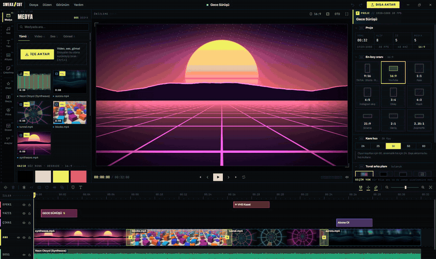</a>
</p>
<p align="center"><sub>From the start screen to the export: a recipe builds a beat montage, a talking clip gets captions, their style changes, the command palette opens. <a href="docs/media/tour.mp4">Watch the tour as MP4</a>.</sub></p>

<br>

## What it is

SWEAXCUT is a video editor for Windows, made by Sweax Studios. Drop your clips onto one of six recipes and it builds the edit: cuts on the beat of the music, removes the pauses in speech, finds the loud moments in gameplay, writes the captions word by word. Everything it builds stays editable on a multi-track timeline, drawn by the same WebGL2 compositor that renders the export.

Speech recognition (whisper.cpp), text to speech (Piper) and the effects run on your computer. The source code is MIT-licensed.

> [!NOTE]
> The interface is in Turkish. Captions can be made in Turkish, English and other languages.

<br>

## New in 3.0

| | |
|---|---|
| **Redesigned from scratch** | Start screen, editor, every panel, the inspector, the timeline, the dialogs and the export. |
| **Recipes on the start screen** | Drop files on a recipe card and the edit is built. Each card plays a small live preview. |
| **Automatic tab** | Six recipes, Polish (eight steps) and eight looks that set colour, transitions and caption style together. |
| **Captions** | One click from the clip, three accuracy levels, music and game sound skipped, a text editor, a style editor, 45 presets plus your own. |
| **Command palette** | <kbd>Ctrl</kbd>+<kbd>K</kbd> searches commands, recipes and everything in the library. |
| **For pros** | Keyframe curve editor, colour scopes, ambient light around the preview. |
| **Export presets** | Six presets, from Social media to Audio only. |
| **Guide** | Four steps on an empty timeline (Add, Automatic edit, Captions, Export), then a "next step" strip once files are in. |

<br>

## One-click edits

<p align="center">
  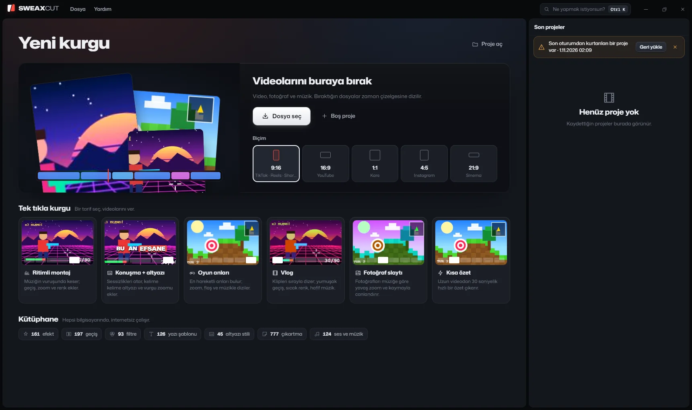
</p>

The start screen has a drop area, five formats (9:16 for TikTok, Reels and Shorts, 16:9, 1:1, 4:5 and 21:9) and the six recipes. Drop your videos onto a recipe card and the edit sets itself up; drop them on the drop area and they go onto the timeline as they are.

| Recipe | What it builds |
|---|---|
| **Beat montage** | Cuts on the beat of the music, a zoom transition every two bars, emphasis zooms, vivid colour |
| **Talk + captions** | Cuts the silences, adds jump zooms and voice clean-up, writes captions word by word, ducks the music under speech |
| **Game moments** | Finds the moments where the sound gets loud and adds a zoom and a flash |
| **Vlog** | Clips in order, soft transitions, golden-hour colour, a date title |
| **Photo slideshow** | A slow zoom or pan for every bar of music |
| **Short recap** | A 30-second recap from a long video |

The tracks in the app's music library have a known tempo, so their beat grid is exact. With your own music, the beats are detected.

<table>
<tr>
<td width="50%" valign="top">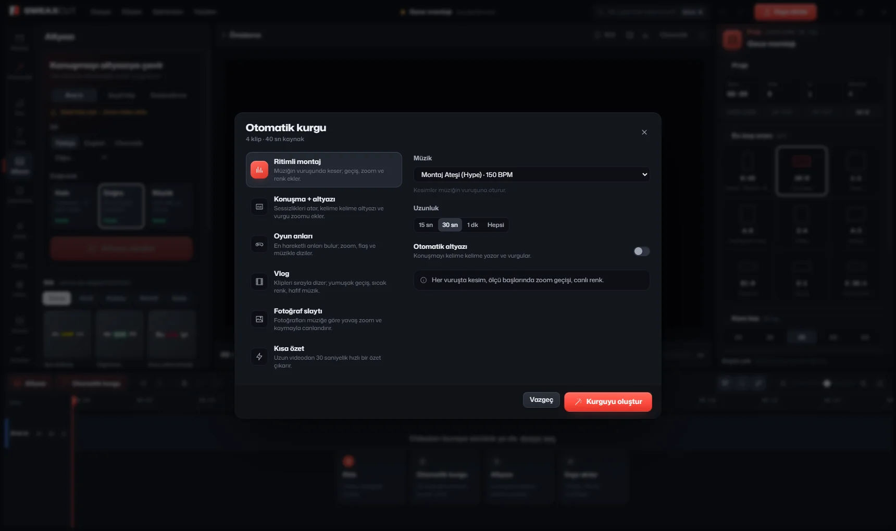</td>
<td width="50%" valign="top">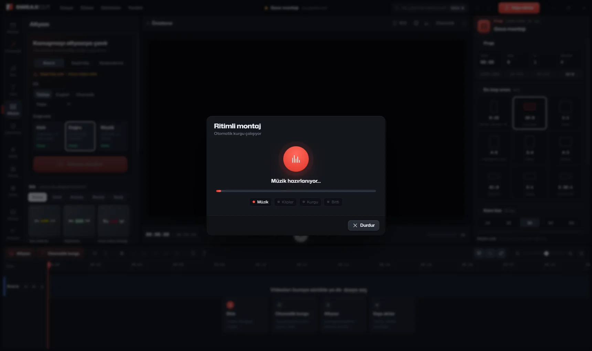</td>
</tr>
<tr>
<td valign="top"><sub>Pick a recipe, the music and the length. The dialog says what the recipe will do before it runs.</sub></td>
<td valign="top"><sub>The recipe runs in four stages: music, clips, edit, done. In the packaged app, three clips dropped on the Beat montage card became a 30-second montage with 38 cuts in 6.3 s.</sub></td>
</tr>
</table>

### Polish

Polish runs over an edit you already have. Each step can be switched on or off before it runs.

| Step | What it does | On by default |
|---|---|:---:|
| Cut silences | Removes the pauses in speech | |
| Clean up and level the voice | Noise reduction, clarity, loudness levelling | ✓ |
| Improve the colour | A little contrast and vibrance | ✓ |
| Transitions on the cuts | A soft blend, 0.35 s | ✓ |
| Emphasis zoom | Zooms in where the sound gets louder | |
| Automatic captions | Writes the speech word by word | |
| Background music | Ducks by itself under speech | |
| Intro and outro | Fades in at the start and out at the end | ✓ |

### Looks

A look sets the colour filter, the transitions and the caption style in one click. There are eight: **Cinematic, Energetic, Clean, Gaming, Warm vlog, Retro, Neon night** and **Black and white**.

### Command palette

<p align="center">
  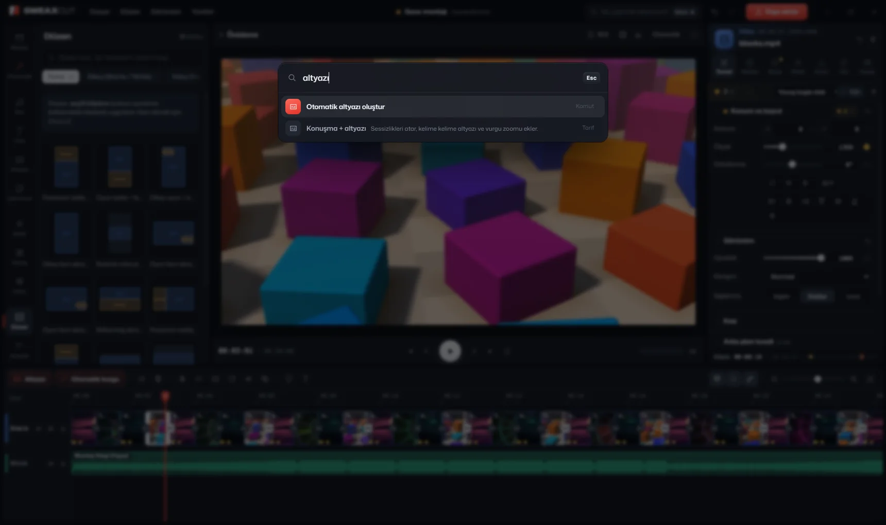
</p>

<kbd>Ctrl</kbd>+<kbd>K</kbd> opens *Ne yapmak istiyorsun?* ("What do you want to do?"). One search covers the commands, the recipes and every effect, transition, filter, text template and music track in the library.

<br>

## Automatic captions

Captions are made by [whisper.cpp](https://github.com/ggml-org/whisper.cpp) (release `b5454`) on your own computer. Each word gets its own timing, so the spoken word can be highlighted.

<table>
<tr>
<th width="33%">1 · Create</th>
<th width="33%">2 · Edit</th>
<th width="33%">3 · Style</th>
</tr>
<tr>
<td valign="top">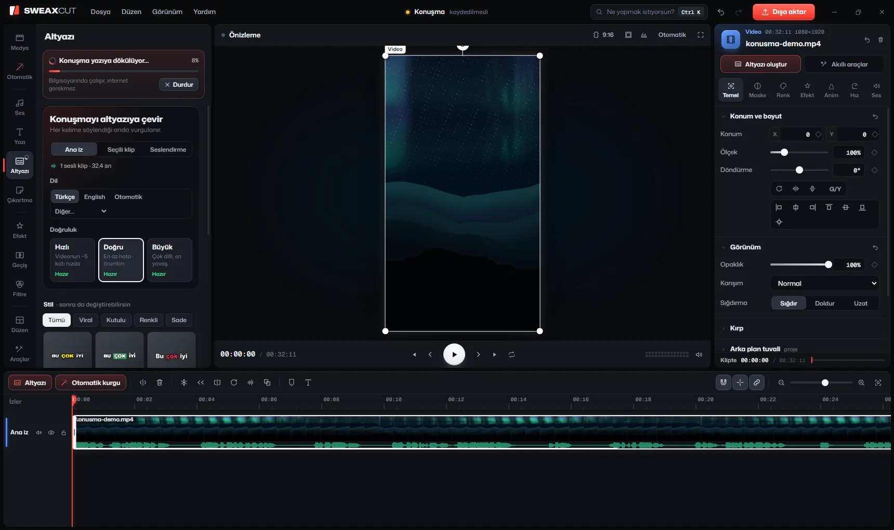</td>
<td valign="top">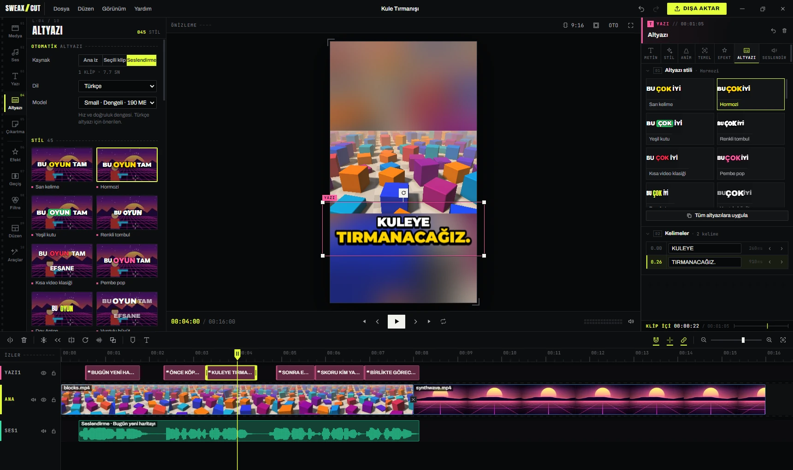</td>
<td valign="top">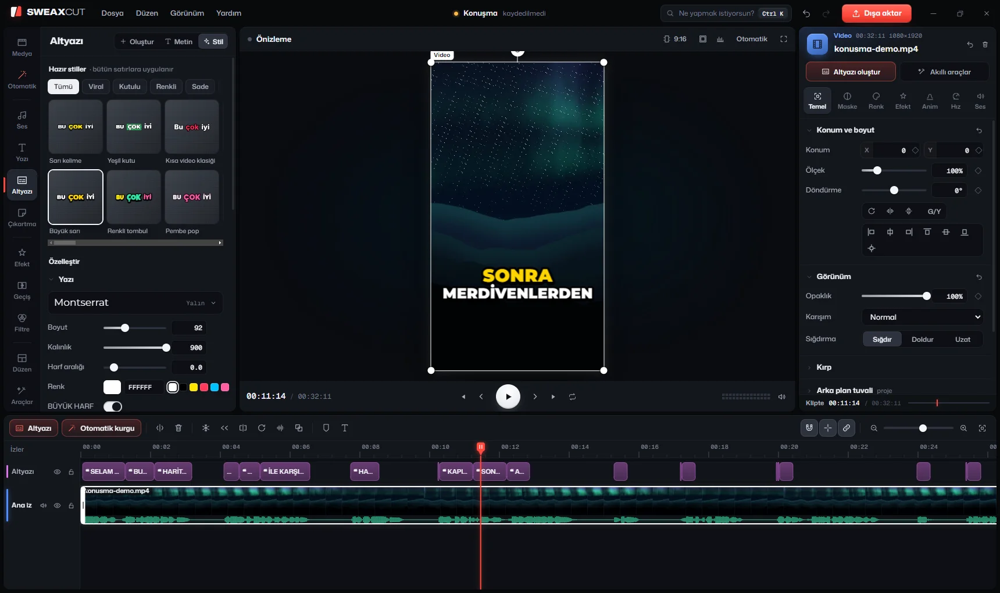</td>
</tr>
</table>

**Create.** Click *Altyazı oluştur* in the clip's inspector, *Altyazı* on the timeline toolbar, or use the clip's right-click menu.

| Accuracy | Model | Download |
|---|---|---:|
| Fast | small | 190 MB |
| **Accurate** (recommended) | medium | 539 MB |
| Large | large-v3-turbo | 574 MB |

Word timing comes from DTW. *Skip music and game sound* runs Silero VAD first, and a filter drops made-up text, such as the "bzzzz" a model can write over gameplay sound with no speech in it.

**Edit.** All the lines read like one document:

- click a word to jump to that moment, double-click to type
- <kbd>Enter</kbd> splits the line at the cursor, <kbd>Backspace</kbd> at the start of a line joins it to the previous one
- move a start or end frame by frame (<kbd>Shift</kbd>: 0.1 s), or shift every caption at once to fix the sync
- find and replace
- export as SRT, VTT, ASS or TXT; import SRT, VTT or ASS

**Style.** Changes apply to every line at once and show live in the preview.

| | Options |
|---|---|
| Text | font, size, weight, letter spacing, colour, UPPERCASE with the Turkish rules (i → İ) |
| Spoken word | Colour, Box, Underline, Karaoke fill or None, with its colour, box corner radius, grow and bounce |
| Words still to come | their own opacity |
| Word entrance | Pop, Fade in, Slide, Drop, Punch, Blur, Typewriter, Spin, Stretch |
| Continuous motion | Pulse, Sway, Float |
| Extras | emoji, outline, shadow, glow |
| Background | per line, as a block, or behind each word |
| Layout | top, middle or bottom, vertical and horizontal offset, width, words per line (re-split using the word timings) |

45 preset styles are drawn with the real caption renderer. *Bu stili kaydet* saves your own style under *Kaydettiklerim* (`caption-styles.json` in the app's data folder).

### Measured accuracy

66 seconds of Turkish speech made with a TTS voice, all five models run by `scripts/test-captions.cjs --models=all` on an AMD Ryzen 5 7600, on the processor (whisper did not use the GPU).

| Model | Word error rate | Time for 66 s |
|---|---:|---:|
| tiny | 23.9 % | |
| base | 16.2 % | |
| small · *Fast* | 6.0 % | 13.5 s |
| **medium · *Accurate*** | **2.6 %** | **42.6 s** |
| large-v3-turbo · *Large* | 5.1 % | 78.3 s |

The median error of a word's timing was 29 to 49 ms. On 39 seconds of English (the Windows voice Zira), medium got every word right in about 26 to 32 s. In the packaged app, the clip's *Altyazı oluştur* button turned 32 seconds of Turkish speech into 22 lines and 53 words in 43 s with medium.

<br>

## The library

<table>
<tr>
<td width="33%" valign="top" align="center">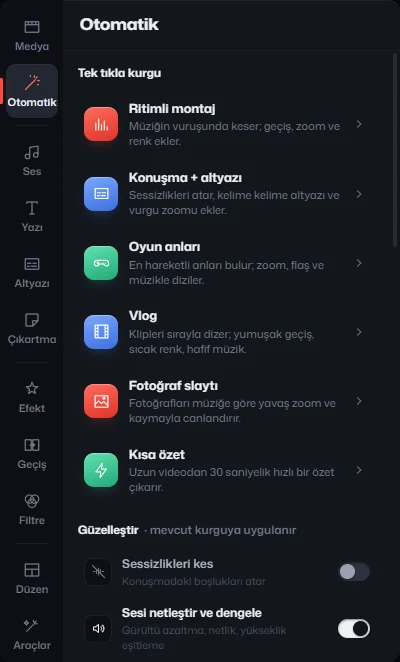<br><b>Automatic</b><br><sub>6 recipes · Polish · 8 looks</sub></td>
<td width="33%" valign="top" align="center">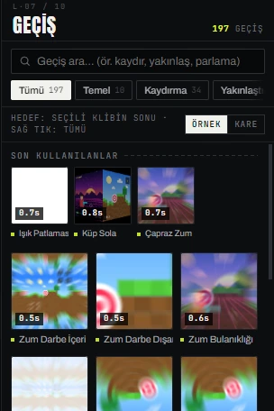<br><b>197 transitions</b><br><sub>125 from gl-transitions, 72 written for SWEAXCUT</sub></td>
<td width="33%" valign="top" align="center">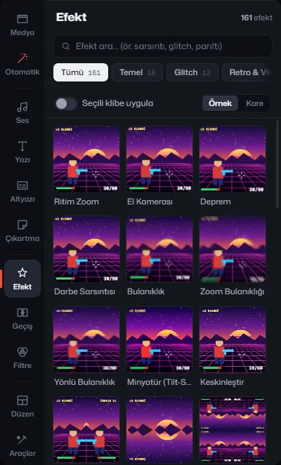<br><b>161 effects</b><br><sub>on a clip or on their own layer</sub></td>
</tr>
<tr>
<td valign="top" align="center">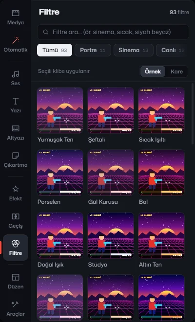<br><b>93 colour filters</b><br><sub>with HSL and an adjustment layer</sub></td>
<td valign="top" align="center">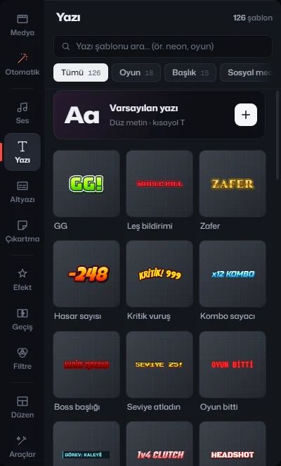<br><b>126 text templates</b><br><sub>88 animations, 101 fonts with Turkish letters</sub></td>
<td valign="top" align="center">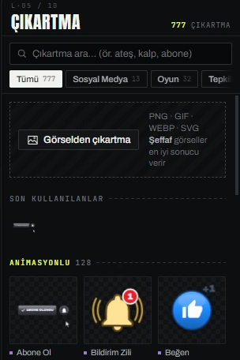<br><b>777 stickers</b><br><sub>Twemoji and vector stickers</sub></td>
</tr>
<tr>
<td valign="top" align="center">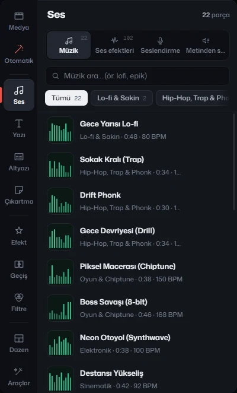<br><b>102 sound effects, 22 tracks</b><br><sub>synthesised by the app; 40 voice changers</sub></td>
<td valign="top" align="center">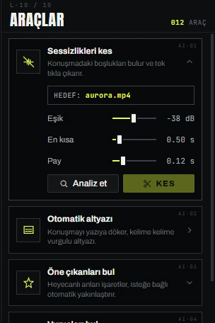<br><b>Tools</b><br><sub>background removal, stabilisation, reframe, scenes</sub></td>
<td valign="top" align="center">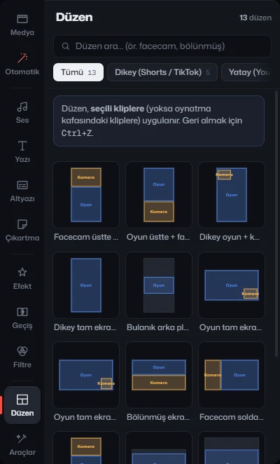<br><b>13 layouts</b><br><sub>facecam, split screen and more</sub></td>
</tr>
</table>

Counted from the app's content registry (`src/engine/registry.js`):

| | Count | |
|---|---:|---|
|  Effects | **161** | |
|  Transitions | **197** | 125 gl-transitions + 72 written for SWEAXCUT |
|  Colour filters | **93** | |
|  Text templates | **126** | |
|  Text animations | **88** | |
|  Fonts | **101** | all with the Turkish letters |
|  Caption styles | **45** | plus the ones you save |
|  Stickers | **777** | Twemoji (CC-BY 4.0) and vector |
|  Sound effects | **102** | synthesised by the app |
|  Music tracks | **22** | synthesised by the app |
|  Voice changers | **40** | |
|  Clip animations | **137** | |
|  Speed curves | **22** | plus a custom curve |
|  Layouts | **13** | |
|  Automatic edit recipes | **6** | |
|  Looks | **8** | |
|  Export presets | **6** | |

<br>

## For pros

<p align="center">
  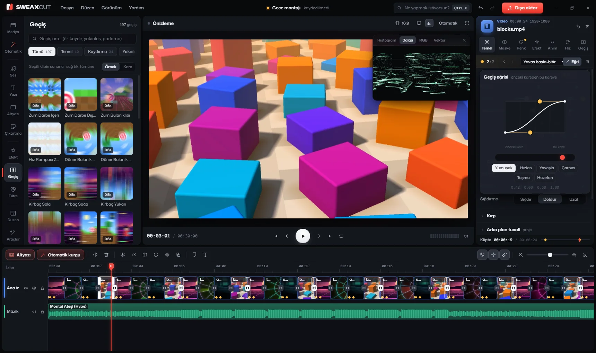
</p>

New in 3.0:

- **Keyframe curve editor.** A two-handle Bézier between two keyframes, with values from −0.5 to 1.5 so a move can overshoot or pull back first. Six presets: Smooth, Speed up, Slow down, Punchy, Overshoot, Anticipate.
- **Colour scopes.** Histogram, luma waveform, RGB parade and vectorscope with a skin-tone line.
- **Ambient light.** The area around the preview takes its colour from the frame.

Still there from earlier versions:

| Area | |
|---|---|
| Animation | keyframes, 137 clip animations, 22 speed curves and a custom curve |
| Compositing | masks, chroma key, blend modes, adjustment layers |
| Colour | 93 filters, HSL |
| Video tools | background removal (MediaPipe), stabilisation (ffmpeg vidstab), auto reframe, scene splitting |
| Audio | noise reduction, voice clarity, loudness levelling, ducking, 40 voice changers |
| Voice-over | Piper text to speech, with the Turkish voice Fahrettin built in |

<br>

## Export

<p align="center">
  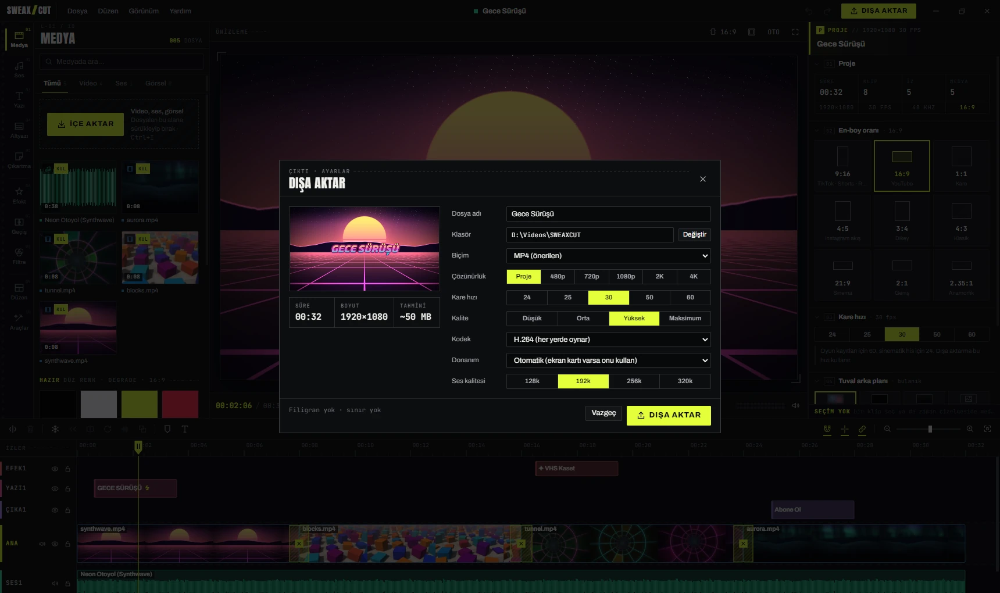
</p>

| Preset | Output |
|---|---|
| Social media | 1080p, 30 fps, H.264 |
| YouTube | 1080p, 60 fps |
| Highest | 4K, H.265 |
| Quick share | 720p |
| GIF | a looping animated image |
| Audio only | MP3, 320 kbps |

Every field under the presets can still be changed by hand. Encoding uses the graphics card when it can (NVIDIA NVENC, AMD AMF, Intel Quick Sync), and the frames come from the same WebGL2 compositor as the preview. The dialog adds no watermark.

<p align="center">
  <picture>
    <source media="(prefers-color-scheme: dark)" srcset="docs/art/pipeline-en-dark.svg">
    
  </picture>
</p>

During an export, each clip is decoded by its own ffmpeg process, every frame is composited by the WebGL2 compositor (`src/engine/compositor.js`), converted to BT.709 YUV 4:2:0 on the graphics card, read back and handed to the encoder. The audio is mixed to WAV alongside and muxed in at the end. [An exported sample](docs/media/export-sample.mp4) is in the repository.

<br>

## Measured on one machine

Packaged app, end-to-end scripts, AMD Ryzen 5 7600.

| Task | Result |
|---|---|
| Three clips dropped on the *Beat montage* recipe card | a 30-second montage with 38 cuts, built in **6.3 s** |
| *Altyazı oluştur* on a clip with 32 s of Turkish speech (medium) | 22 lines, 53 words in **43 s** |
| Export of a 32-second 1080×1920 project with `h264_nvenc` | **23.8 s** |
| Captions for 66 s of Turkish TTS speech, medium | 2.6 % word error rate in **42.6 s** |

<br>

## Keyboard shortcuts

| Key | Action | Key | Action |
|---|---|---|---|
| <kbd>Ctrl</kbd>+<kbd>K</kbd> | Command palette | <kbd>J</kbd> <kbd>K</kbd> <kbd>L</kbd> | Shuttle back, stop, forward |
| <kbd>Space</kbd> | Play / pause | <kbd>←</kbd> <kbd>→</kbd> | One frame back / forward |
| <kbd>Ctrl</kbd>+<kbd>B</kbd> or <kbd>S</kbd> | Split at the playhead | <kbd>Shift</kbd>+<kbd>←</kbd> <kbd>→</kbd> | One second back / forward |
| <kbd>Q</kbd> / <kbd>W</kbd> | Trim left / right of the playhead | <kbd>↑</kbd> <kbd>↓</kbd> | Previous / next cut |
| <kbd>Delete</kbd> | Delete | <kbd>Home</kbd> <kbd>End</kbd> | Start / end |
| <kbd>Shift</kbd>+<kbd>Delete</kbd> | Delete and close the gap | <kbd>I</kbd> <kbd>O</kbd> | Range in / out |
| <kbd>Ctrl</kbd>+<kbd>Z</kbd> / <kbd>Ctrl</kbd>+<kbd>Y</kbd> | Undo / redo | <kbd>M</kbd> | Add a marker |
| <kbd>Ctrl</kbd>+<kbd>C</kbd> <kbd>X</kbd> <kbd>V</kbd> | Copy, cut, paste | <kbd>T</kbd> | Add text |
| <kbd>Ctrl</kbd>+<kbd>D</kbd> | Duplicate | <kbd>Alt</kbd>+<kbd>K</kbd> | Add a keyframe |
| <kbd>Ctrl</kbd>+<kbd>A</kbd> | Select all | <kbd>[</kbd> <kbd>]</kbd> | Previous / next keyframe |
| <kbd>Ctrl</kbd>+<kbd>+</kbd> / <kbd>−</kbd> | Zoom the timeline | <kbd>N</kbd> | Snapping on / off |
| <kbd>Shift</kbd>+<kbd>Z</kbd> | Fit the timeline | <kbd>F</kbd> | Full-screen preview |
| <kbd>Ctrl</kbd>+<kbd>S</kbd> | Save | <kbd>Ctrl</kbd>+<kbd>O</kbd> | Open a project |
| <kbd>Ctrl</kbd>+<kbd>E</kbd> | Export | <kbd>Ctrl</kbd>+<kbd>I</kbd> | Import media |

The same list is in the app under **Yardım → Klavye kısayolları** (`src/ui/shortcuts.js`).

<br>

## Privacy

Your videos are edited on your computer and are not uploaded anywhere. There is no account, and the code has no analytics, telemetry or update check.

The app goes online in two situations, and only when you start them:

| When | From | What |
|---|---|---|
| You make captions with a model that is not on your disk yet | `huggingface.co/ggerganov/whisper.cpp`, or the `hf-mirror.com` mirror | the model file, checked against its size and SHA-256 |
| You pick a Piper voice that is not installed yet | `huggingface.co` (`rhasspy/piper-voices`, `speaches-ai`) | the voice model and its config |

Everything else (the Silero VAD model, the MediaPipe models, fonts, stickers, music and sound effects) comes with the installer.

<br>

## Where your files live

| What | Where |
|---|---|
| Projects (`.sweax`) | `Documents\SWEAXCUT\Projeler` |
| Autosave, every 45 seconds | `%APPDATA%\SWEAXCUT\autosave\` |
| Saved caption styles | `%APPDATA%\SWEAXCUT\caption-styles.json` |
| Preview copies, waveforms, thumbnails | `%APPDATA%\SWEAXCUT\cache\` |
| Downloaded speech models | `%APPDATA%\SWEAXCUT\models\whisper\` |
| Exports | `Videos\SWEAXCUT`, or any folder you pick in the export dialog |

<br>

## Install

1. Download `SWEAXCUT-Kurulum-3.0.0.exe` (about 214 MB) from the [latest release](https://github.com/Sweax3169/sweaxcut/releases/latest).
2. Run it. It installs for your user account, adds desktop and Start menu shortcuts, registers `.sweax` project files and opens the app.
3. Drop your videos on a recipe card, or on the drop area to edit them yourself.

> [!IMPORTANT]
> The installer is not code-signed, so Windows SmartScreen may show a blue warning the first time. Click **More info**, then **Run anyway**.

**Requirements:** 64-bit Windows 10 or 11 and a graphics card with WebGL 2. A hardware video encoder (NVIDIA, AMD or Intel) makes exports faster but is not required.

<br>

## FAQ

<details>
<summary><b>Does it need the internet?</b></summary>
<br>
Only to download a speech model the first time you make captions with it, and to download extra Piper voices. Editing, effects, the recipes, the bundled Turkish voice and the export work offline.
</details>

<details>
<summary><b>Is there an English interface?</b></summary>
<br>
Not yet; the interface is in Turkish. Captions can be made in English: pick <i>English</i> (or <i>Otomatik</i> for automatic detection) under <i>Dil</i> in the captions panel.
</details>

<details>
<summary><b>Which caption accuracy should I pick?</b></summary>
<br>
<i>Doğru</i> (Accurate, medium) is the recommended one and made the fewest errors in the measurement above, 2.6 % on Turkish. <i>Hızlı</i> (Fast, small) took 13.5 s instead of 42.6 s for the same 66 seconds, with 6.0 % errors.
</details>

<details>
<summary><b>The captions wrote nonsense over a gameplay clip with no talking.</b></summary>
<br>
Turn on <i>Müzik ve oyun sesini atla</i> (skip music and game sound). It runs voice activity detection before whisper, and a filter removes made-up text such as "bzzzz".
</details>

<details>
<summary><b>Can I use the downloadable Turkish voice <code>tr_TR-dfki-medium</code> in a commercial video?</b></summary>
<br>
No. That voice is licensed CC BY-NC-SA 4.0, which does not allow commercial use. The bundled voice Fahrettin is CC0. <a href="THIRD_PARTY_NOTICES.md">THIRD_PARTY_NOTICES.md</a> lists the licence of every voice.
</details>

<details>
<summary><b>Windows says the installer is from an unknown publisher.</b></summary>
<br>
The installer is not code-signed. Click <b>More info</b>, then <b>Run anyway</b>. You can also build it yourself from this repository.
</details>

<details>
<summary><b>The app closed unexpectedly. Is my project gone?</b></summary>
<br>
The project is autosaved every 45 seconds to <code>%APPDATA%\SWEAXCUT\autosave\</code>, and the start screen offers to restore it the next time you open the app.
</details>

<br>

## Build from source

```bash
git clone https://github.com/Sweax3169/sweaxcut.git
cd sweaxcut
npm install                # also copies the MediaPipe wasm runtime into public/
npm run prepare:vendor     # downloads Piper, the bundled Turkish voice and FFprobe into vendor/
```

whisper.cpp is not fetched by a script. Put the files from `whisper-blas-bin-x64.zip` of the [`b5454` release](https://github.com/ggml-org/whisper.cpp/releases/tag/b5454) and the Microsoft Visual C++ runtime DLLs into `vendor/whisper/bin/`. None of these binaries are kept in git; see [THIRD_PARTY_NOTICES.md](THIRD_PARTY_NOTICES.md).

```bash
npm run dev                # Vite dev server
npm run start:dev          # Electron window connected to it
npm run dist               # production build and NSIS installer in release/
```

The images in this README come from the running app. `scripts/docs-media/footage.html` renders the sample footage from original GLSL scenes, `drive.cjs` drives the app over the Chrome DevTools Protocol, `encode.cjs` makes the MP4 and GIF, `readme-art.cjs` draws the banner and the architecture diagram, and `site-build.cjs` updates the website's fonts and shader data.

<br>

## Project structure

```
sweaxcut/
├─ electron/main.cjs        main process: window, file dialogs, paths
├─ src/
│  ├─ core/                 project model, undo store, timeline operations, keyframes, media import
│  ├─ engine/               WebGL2 compositor, shaders, playback, audio, text and sticker rendering
│  │  └─ export/            decoders, GPU YUV packing, encoder selection, audio mix
│  ├─ features/             autoedit (recipes, Polish, looks), captions (whisper.cpp), tts (Piper),
│  │                        video (background removal, stabilise, reframe, scenes), audio (beats, silence)
│  ├─ packs/                effects, transitions, filters, text, fonts, stickers, sfx, music, layouts
│  ├─ platform/node.js      the only place the interface touches Node
│  └─ ui/                   start screen, editor, library, inspector, timeline, preview, styles
├─ public/                  fonts, Twemoji SVGs, MediaPipe models
├─ vendor/                  Piper, whisper.cpp, FFprobe (binaries not in git)
├─ scripts/                 vendor download, test drivers, documentation media
└─ docs/                    website, README art, screenshots, licence notes
```

<br>

## Credits and licences

SWEAXCUT is made by **Sweax Studios** and builds on these open projects:

| Component | Used for | Licence |
|---|---|---|
| [FFmpeg](https://ffmpeg.org) 6.1.1, build by [gyan.dev](https://www.gyan.dev/ffmpeg/builds/) | decoding, encoding, stabilisation, audio filters; run as a separate program | GPL |
| [whisper.cpp](https://github.com/ggml-org/whisper.cpp) | automatic captions | MIT |
| [Piper](https://github.com/rhasspy/piper) and [eSpeak NG](https://github.com/espeak-ng/espeak-ng) | text to speech | MIT, GPL |
| [MediaPipe](https://github.com/google-ai-edge/mediapipe) | background removal, face detection | Apache-2.0 |
| [gl-transitions](https://github.com/gl-transitions/gl-transitions) | 125 of the 197 transitions | MIT |
| [Twemoji](https://github.com/jdecked/twemoji) | emoji stickers | CC-BY 4.0 |
| 101 font families from Google Fonts via Fontsource, plus Mona Sans and Geist Mono | text templates, the interface | SIL Open Font License (Luckiest Guy: Apache-2.0) |
| Piper voice `tr_TR-dfki-medium` (optional download) | Turkish voice | CC BY-NC-SA 4.0, **non-commercial** |

Every bundled component, its licence and its source are listed in **[THIRD_PARTY_NOTICES.md](THIRD_PARTY_NOTICES.md)**. The effects, filters, 72 of the transitions, the vector stickers, the music and the sound effects were made for SWEAXCUT.

## License

The SWEAXCUT source code is released under the [MIT License](LICENSE). © 2026 Sweax Studios.
