<a href="https://sweax3169.github.io/sweaxcut/">
  <picture>
    <source media="(prefers-color-scheme: dark)" srcset="docs/art/banner-tr-dark.svg">
    
  </picture>
</a>

<p align="center">
  <a href="https://github.com/Sweax3169/sweaxcut/releases/latest"><b>Windows için indir</b></a>
  &nbsp;&nbsp;·&nbsp;&nbsp;
  <a href="https://sweax3169.github.io/sweaxcut/">İnternet sitesi</a>
  &nbsp;&nbsp;·&nbsp;&nbsp;
  <a href="README.md">English</a>
</p>

<p align="center">
  <a href="https://github.com/Sweax3169/sweaxcut/releases/latest"></a>
  <a href="https://github.com/Sweax3169/sweaxcut/releases"></a>
  
  <a href="LICENSE"></a>
</p>

<br>

<p align="center">
  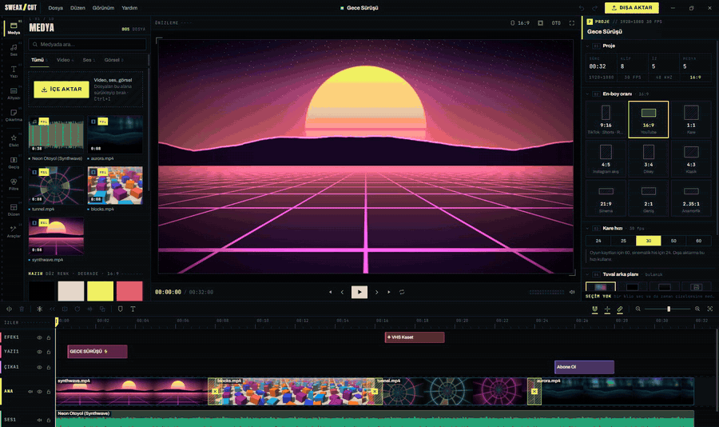
</p>
<p align="center"><sub>Düzenleyicide oynatılan bir proje: hareketli başlık, çapraz zum kesmesi, ardından kütüphaneden seçilen yeni bir geçiş. <a href="docs/media/tour.mp4">32 saniyelik turun tamamını izle (MP4)</a>.</sub></p>

<br>

## Nedir

SWEAXCUT, Sweax Studios'un Windows için yaptığı bir video kurgu programı. Oyun kaydı, Shorts ve YouTube videosu kurgulayanlar düşünülerek hazırlandı. Çok izli zaman çizelgesi ve ekran kartıyla çizilen önizlemenin yanında efekt, geçiş, yazı stili, çıkartma, müzik ve ses efektlerinden oluşan geniş bir kütüphane, otomatik altyazı, metinden sese ve yapay zekâ araçları var. Konuşma tanıma ve seslendirme dahil hepsi senin bilgisayarında çalışır.

Kullanımı ücretsizdir, dışa aktardığın videoya filigran basmaz. Hesap açman gerekmez.

> [!NOTE]
> Arayüz Türkçedir. Altyazı 12 dilde çıkarılabilir; indirilebilir sesler 10 dili kapsar.

<br>

## İçinde neler var

<table>
<tr>
<td width="33%" valign="top">
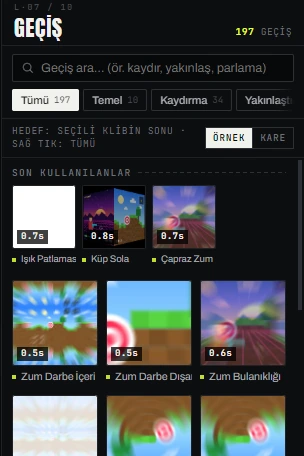
<h3>197 geçiş</h3>
<p>Kırbaç, zum, ışık patlaması, glitch, 3D küp, şekilli açılımlar. 125'i gl-transitions'tan, 72'si SWEAXCUT için yazıldı.</p>
</td>
<td width="33%" valign="top">
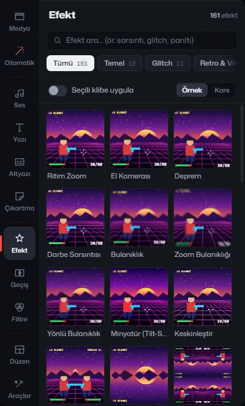
<h3>161 efekt</h3>
<p>VHS, tüplü ekran, film greni, glitch, hava durumu, ışık sızıntısı, kamera sarsıntısı, oyun çerçeveleri. Klibe ya da ayrı bir katmana uygulanır.</p>
</td>
<td width="33%" valign="top">
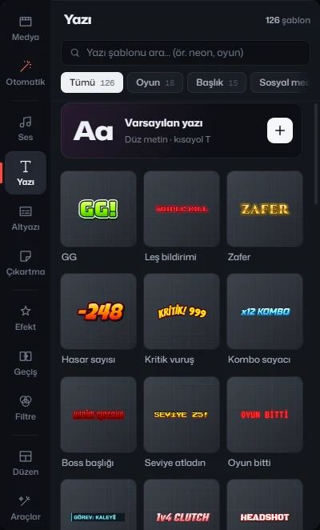
<h3>126 yazı şablonu</h3>
<p>Hepsi Türkçe harfleri içeren 101 yazı tipi, 88 yazı animasyonu, kontur, gölge, parlama, arka plan kutusu ve kavisli yazı.</p>
</td>
</tr>
<tr>
<td width="33%" valign="top">
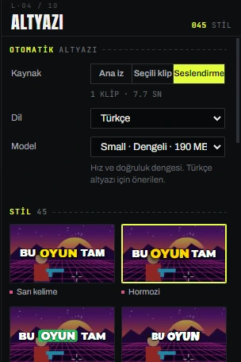
<h3>Otomatik altyazı</h3>
<p>whisper.cpp konuşmayı bilgisayarında, kelime zamanlı altyazıya çevirir. 45 altyazı stili, anahtar kelime vurgusu ve emoji.</p>
</td>
<td width="33%" valign="top">
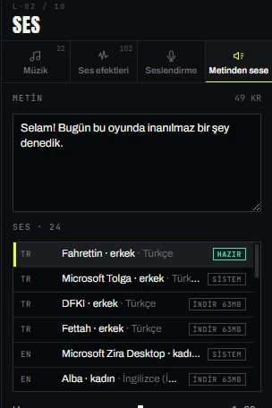
<h3>Metinden sese</h3>
<p>İnternetsiz çalışan Piper sesleri; Türkçe bir ses kurulumla gelir. Windows'un kendi sesleri de kullanılabilir.</p>
</td>
<td width="33%" valign="top">
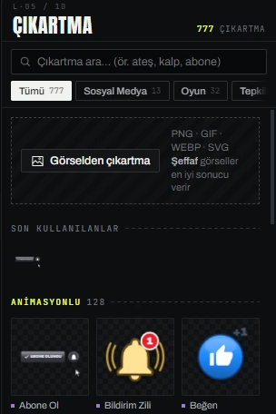
<h3>777 çıkartma</h3>
<p>649 Twemoji emojisi, 117 animasyonlu vektör çıkartma (abone ol düğmesi, can barı, leş sayacı, çizgi roman patlamaları) ve 11 şekil.</p>
</td>
</tr>
<tr>
<td width="33%" valign="top">
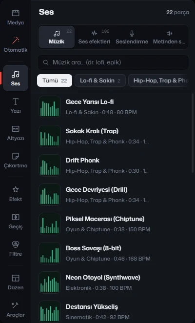
<h3>Müzik ve ses efektleri</h3>
<p>Hepsini programın kendisinin sentezlediği 22 müzik ve 102 ses efekti. 40 ses değiştirici, gürültü azaltma ve konuşmada müziği kısma.</p>
</td>
<td width="33%" valign="top">
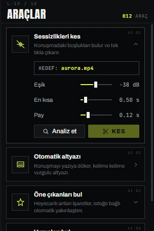
<h3>Yapay zekâ araçları</h3>
<p>Arka plan silme, görüntü sabitleme, otomatik kadraj, sahne bölme, sessizlik kesme, öne çıkan anları ve vuruşları bulma.</p>
</td>
<td width="33%" valign="top">
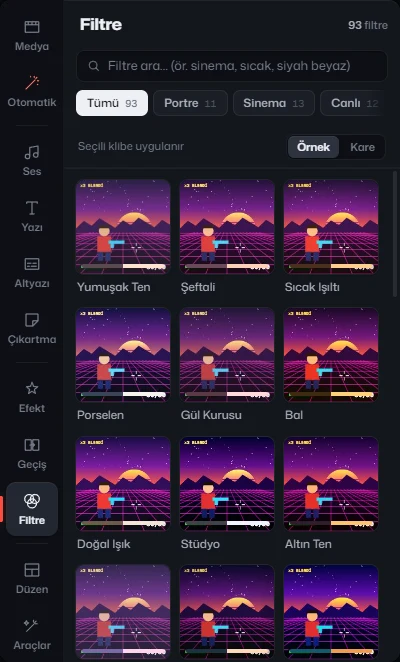
<h3>Renk</h3>
<p>93 renk filtresi, ışık ve renk ayarları, sekiz renk aralığı için HSL. Işık ve renk kaydırıcılarına anahtar kare konabilir.</p>
</td>
</tr>
</table>

<br>

## Koddan sayıldı

Bu sayılar bir özellik listesinden değil, çalışan programın içerik kayıt defterinden (`src/engine/registry.js`, sürüm 2.0.1) alındı.

| | Adet | Ayrıntı |
|---|---:|---|
|  Efekt | **161** | temelden oyuna, glitch'ten retroya ve havaya 11 kategori |
|  Geçiş | **197** | 12 kategori · 125'i gl-transitions, 72'si özgün |
|  Renk filtresi | **93** | 8 kategori |
|  Klip animasyonu | **137** | 46 giriş · 56 çıkış · 35 döngü |
|  Hız eğrisi | **22** | 5 kategori |
|  Düzen | **13** | facecam ve oyun, bölünmüş ekran, sinema bantları ve diğerleri |
|  Yazı şablonu | **126** | 10 kategori |
|  Yazı animasyonu | **88** | 36 giriş · 28 çıkış · 24 döngü |
|  Altyazı stili | **45** | 6 kategori |
|  Yazı tipi | **101** | 7 grup, her biri 12 Türkçe harfin hepsi için denetlendi |
|  Çıkartma | **777** | 649 emoji · 117 animasyonlu vektör · 11 şekil |
|  Ses efekti | **102** | 8 kategori, program içinde sentezlenir |
|  Müzik | **22** | 10 tür, program içinde sentezlenir |
|  Ses değiştirici | **40** | 6 kategori |
| Yumuşatma eğrisi | **38** | anahtar kareler için (`src/core/easing.js`) |
| Karışım modu | **24** | `src/engine/shaders.js` |
| Maske şekli | **8** | doğrusal, ayna, daire, dikdörtgen, kalp, yıldız, elmas, altıgen |
| En-boy oranı | **9** | 9:16, 16:9, 1:1, 4:5, 3:4, 4:3, 21:9, 2:1, 2.35:1 |

<br>

## Kurgu

<p align="center">
  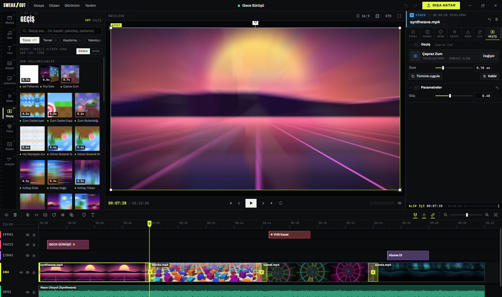
</p>

<table>
<tr>
<td width="50%" valign="top">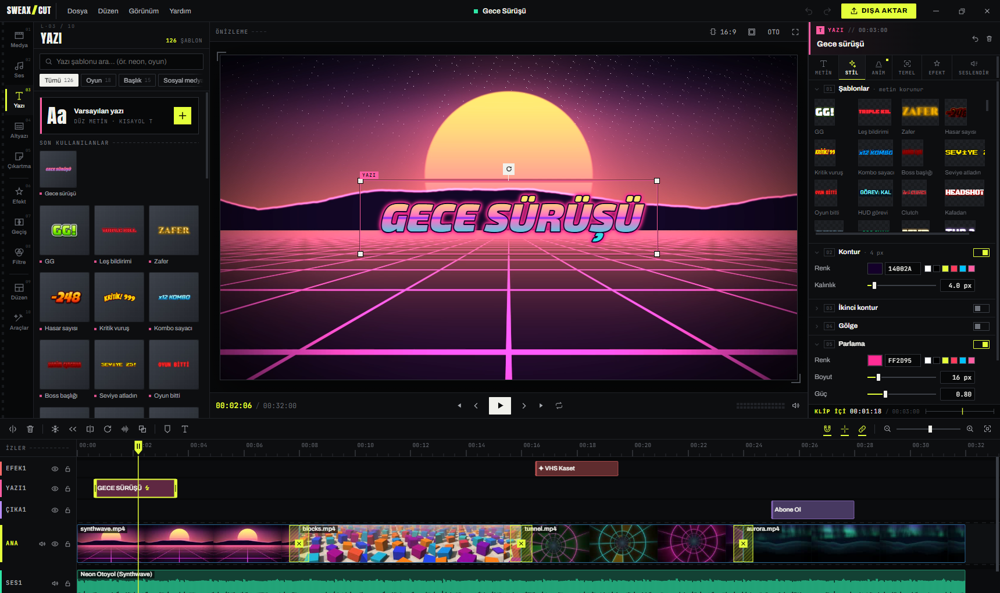</td>
<td width="50%" valign="top">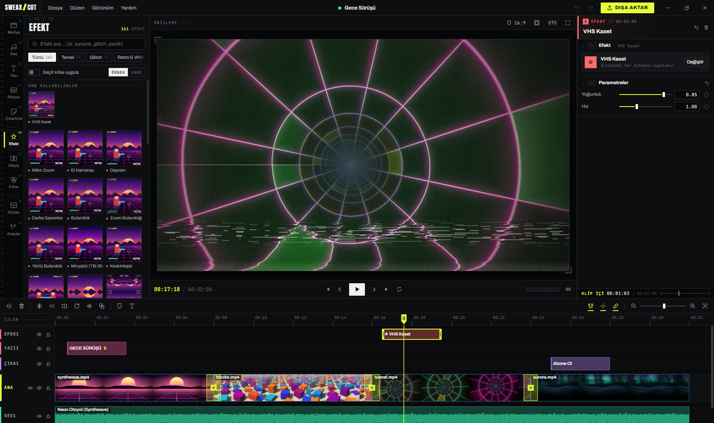</td>
</tr>
<tr>
<td valign="top"><sub>Yazı şablonları ve stil paneli: kontur, ikinci kontur, gölge, parlama, arka plan kutusu.</sub></td>
<td valign="top"><sub>Ayrı katmandaki efekt, sürdüğü boyunca altındaki her şeyi etkiler.</sub></td>
</tr>
<tr>
<td width="50%" valign="top">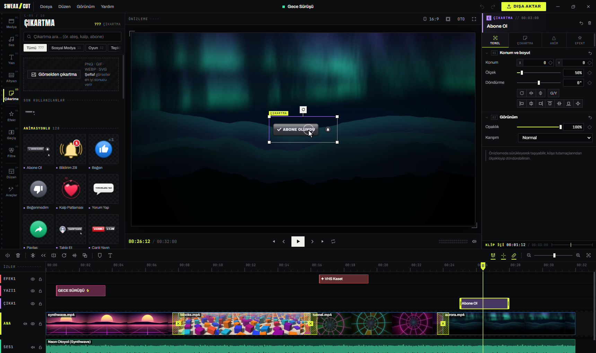</td>
<td width="50%" valign="top">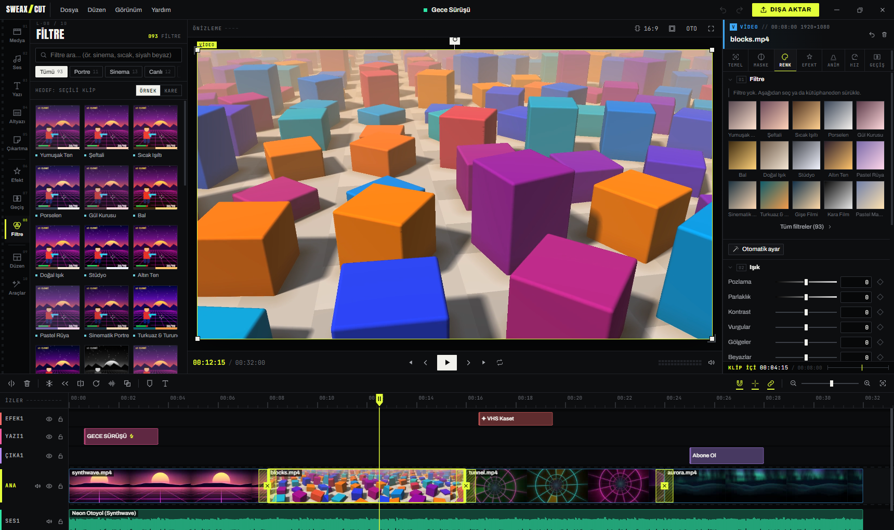</td>
</tr>
<tr>
<td valign="top"><sub>Çıkartma da bir klip: taşınır, büyütülür, canlandırılır, karıştırılır.</sub></td>
<td valign="top"><sub>Yoğunluğu ayarlanabilen renk filtresi, ardından ışık, renk ve HSL ayarları.</sub></td>
</tr>
</table>

- **Zaman çizelgesi.** Ana iz mıknatıslıdır, klipler arada boşluk kalmadan dizilir; üst katman, yazı, çıkartma, efekt ve ses kendi izlerine gider. Bölme, iki yandan kırpma, boşluğu kapatarak silme, kopyalama, çoğaltma, işaretler ve giriş/çıkış aralığı.
- **Anahtar kare:** konum, ölçek, döndürme, opaklık, ses seviyesi, renk ve efekt ayarlarında, 38 yumuşatma eğrisiyle.
- **Hız:** logaritmik kaydırıcıyla 0.1× ile 100× arası, 22 hız eğrisi, ters oynatma, kare dondurma ve perde koruma.
- **Maske, karışım, renk anahtarı.** Yumuşak kenarlı, köşesi yuvarlatılabilen ve tersine çevrilebilen 8 maske şekli, 24 karışım modu, taşma bastırmalı krom anahtar.
- **Projeler** 9 en-boy oranında, 24, 25, 30, 50 ya da 60 kare/sn. 13 tek tık düzen, dikey video için facecam ile oyun görüntüsünü yerleştirir.
- **Ağır kayıtlar** (önizlemenin oynatamadığı biçimler, 1440p üstü, anahtar kare aralığı uzun kayıtlar) için arka planda hafif bir önizleme kopyası hazırlanır; o sırada kurguya devam edebilirsin.

<br>

## Altyazı ve seslendirme

<table>
<tr>
<td width="34%" valign="top" align="center">
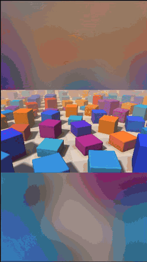
</td>
<td width="66%" valign="top">
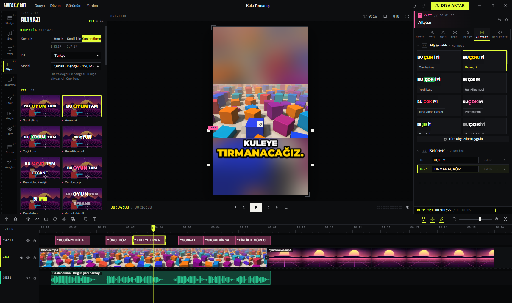
<p><sub>Bu klipteki sesi programla gelen Piper sesi "Fahrettin" okudu, altyazıları da aynı bilgisayarda whisper.cpp çıkardı. Yanlış duyulan tek kelime, senin de yapacağın gibi altyazının kelime düzenleyicisinde düzeltildi.</sub></p>
</td>
</tr>
</table>

**Otomatik altyazı**, ayrı bir süreç olarak çalışan [whisper.cpp](https://github.com/ggml-org/whisper.cpp) (v1.9.5, BLAS derlemesi) ile yapılır. Her kelimenin kendi zamanı olduğundan altyazı stilleri o an söylenen kelimeyi vurgulayabilir. Altyazı ana izden, seçili kliplerden ya da seslendirme izinden, 12 dilde ya da dil otomatik algılanarak çıkarılabilir. Dolgu kelimeleri ("ıı", "şey" gibi) zaman çizelgesinde işaretlenebilir. SRT, VTT ve ASS dosyaları içe aktarılır, SRT olarak dışa aktarılır.

Konuşma modeli ilk altyazıda indirilir, sonra diskinde kalır:

| Model | Boyut | |
|---|---:|---|
| Tiny | 32 MB | en hızlı |
| Base | 60 MB | hızlı |
| **Small** | **190 MB** | **varsayılan, Türkçe için önerilen** |
| Medium | 539 MB | daha doğru |
| Large v3 Turbo | 574 MB | en doğru |

<p align="center">
  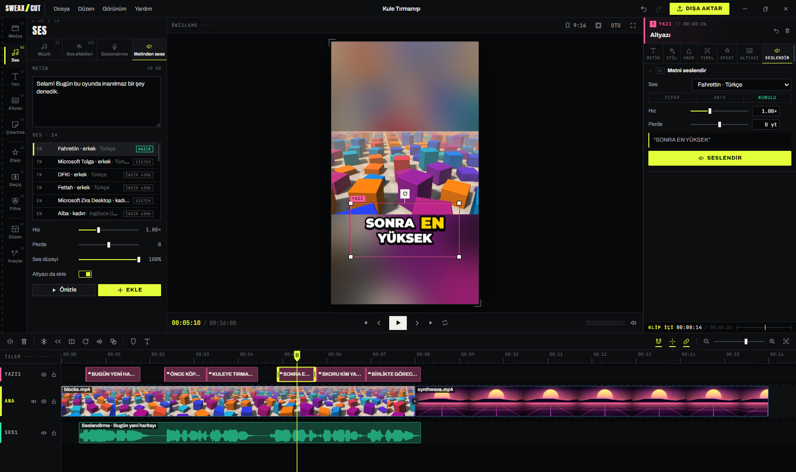
</p>

**Metinden sese** için [Piper](https://github.com/rhasspy/piper) kullanılır. Türkçe *Fahrettin* sesi kurulumla gelir; 10 dilde 21 ses daha program içinden indirilebilir. Windows'un kendi sesleri (OneCore ve SAPI, örneğin *Microsoft Tolga*) de aynı listede. Her yazı klibi kendi panelindeki sekmeden seslendirilebilir, ses altındaki bir ses izine yerleşir. Mikrofonla kayıt da yapabilirsin.

<br>

## Yapay zekâ araçları

<p align="center">
  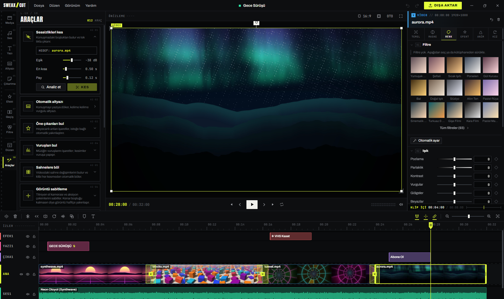
</p>

| Araç | Ne yapar | Nasıl |
|---|---|---|
| Arka planı kaldır | Yeşil perde olmadan kişiyi arka plandan ayırır | MediaPipe Selfie Segmenter; ekran kartında, olmazsa işlemcide |
| Görüntü sabitleme | Titreyen görüntüyü yumuşatır, kenarlar görünmesin diye hafifçe yakınlaşır | ffmpeg vidstab, iki geçiş |
| Otomatik kadraj | 16:9'u 9:16'ya (ya da tersine) çevirirken konuyu kadrajda tutar | MediaPipe yüz algılama, yüz yoksa hareket |
| Sahnelere böl | Klibi her sahne değişiminde keser | ffmpeg sahne algılama |
| Öne çıkanları bul | Ani yüksek sesli anları (vuruş, patlama, bağırış) işaretler, istersen zum ekler | kısa süreli ses yüksekliği, klibin genel seviyesine göre |
| Anlık zoom vuruşu | Oynatma kafasına kısa, sert bir yakınlaşma ekler | anahtar kare |
| Sessizlikleri kes | Konuşmadaki boşlukları bulur ve çıkarır | ffmpeg silencedetect |
| Vuruşları bul | Müziğin vuruşlarını işaretler, kesimler vuruşa yapışır | başlangıç algılama ve vuruş takibi |
| Shorts'a böl | Uzun videoyu eşit parçalara ya da öne çıkan anların çevresinden böler | zaman çizelgesi işaretleri |
| Ses seviyesini eşitle | Bütün klipleri aynı yüksekliğe getirir | ffmpeg loudnorm, dışa aktarmada uygulanır |
| Krom anahtar | Yeşil perdeyi ya da istediğin başka bir rengi siler | bileşimci gölgelendiricisi |

<br>

## Dışa aktarma ve ekran kartı hızlandırması

<p align="center">
  <picture>
    <source media="(prefers-color-scheme: dark)" srcset="docs/art/pipeline-tr-dark.svg">
    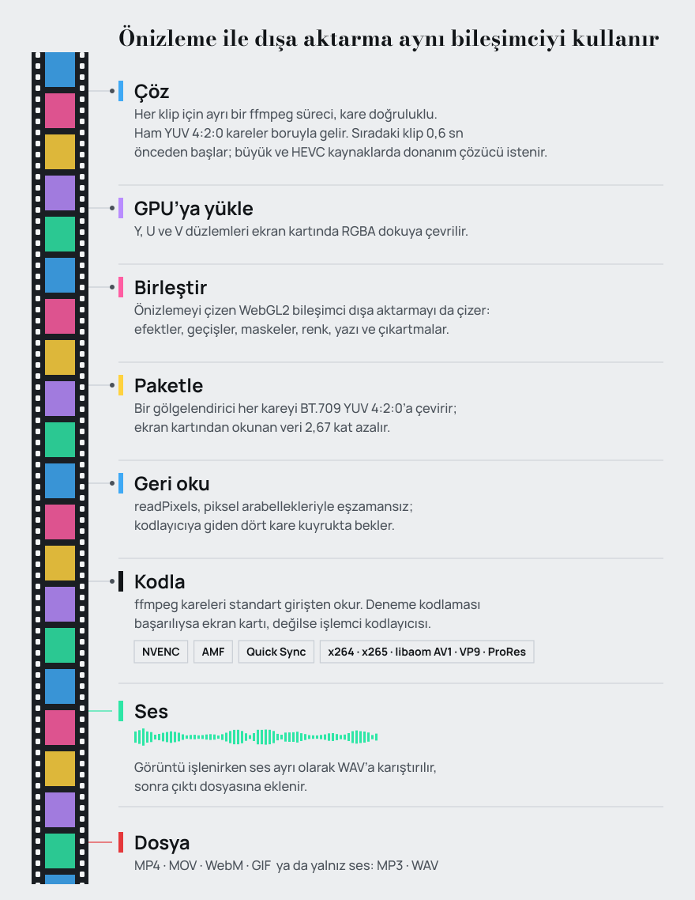
  </picture>
</p>

Önizlemeyi de dışa aktarmayı da aynı WebGL2 bileşimci (`src/engine/compositor.js`) çizer; kurgu sırasında ne görüyorsan dosyaya o çıkar. Dışa aktarmada her klibi kendi ffmpeg süreci kare doğruluğuyla çözer, her kare ekran kartında birleştirilip YUV'a çevrilir, ancak ondan sonra geri okunup kodlayıcıya verilir.

Program açıldıktan birkaç saniye sonra ffmpeg'in listelediği her donanım kodlayıcısıyla (NVIDIA NVENC, AMD AMF, Intel Quick Sync) çok kısa bir deneme kodlaması yapar ve sonucu üç gün hatırlar. Dışa aktarma penceresindeki *Otomatik* seçeneği çalışan ilk kodlayıcıyı, hiçbiri yoksa işlemciyi kullanır.

<table>
<tr>
<td width="62%" valign="top">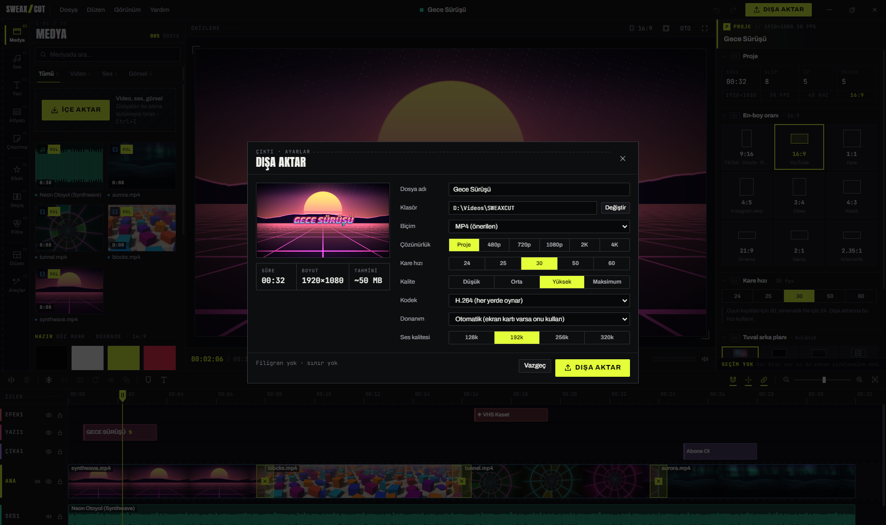</td>
<td width="38%" valign="top">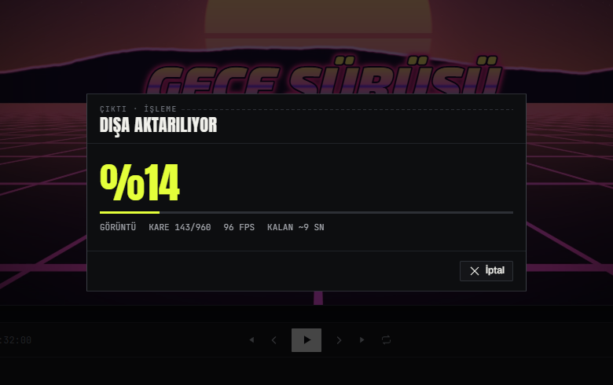
<p><sub>Tek bir bilgisayarda ölçüldü (RTX 4070 SUPER, geliştirme derlemesi): bu ekran görüntülerindeki 32 saniyelik 1080p30 proje (dört klip, üç geçiş, başlık, çıkartma, efekt katmanı ve müzik) <code>h264_nvenc</code> ile <b>12,5 saniyede</b> dışa aktarıldı. <a href="docs/media/export-sample.mp4">Çıkan videoyu izle</a> (web için 960 piksele yeniden kodlandı).</sub></p>
</td>
</tr>
</table>

| | Seçenekler |
|---|---|
| Biçim | MP4, MOV, WebM, GIF; yalnız ses için MP3 ya da WAV |
| Video kodeği | H.264, HEVC (H.265), AV1, VP9, ProRes |
| Donanım kodlayıcıları | NVIDIA NVENC, AMD AMF, Intel Quick Sync; kart destekliyorsa H.264, HEVC ve AV1 |
| İşlemci kodlayıcıları | x264, x265, libaom AV1, libvpx VP9, ProRes (prores_ks) |
| Çözünürlük | proje boyutu, 480p, 720p, 1080p, 2K, 4K |
| Kare hızı | 24, 25, 30, 50, 60 |
| Kalite | Düşük, Orta, Yüksek, Maksimum |
| Ses | AAC (MP4, MOV), Opus (WebM), MP3 ya da WAV; sıkıştırılmış seste 128 ile 320 kbps arası |
| Renk | BT.709, dosyaya etiketlenir |

<br>

## Klavye kısayolları

| Tuş | İş | Tuş | İş |
|---|---|---|---|
| <kbd>Boşluk</kbd> | Oynat / duraklat | <kbd>J</kbd> <kbd>K</kbd> <kbd>L</kbd> | Geri sar, dur, ileri sar |
| <kbd>Ctrl</kbd>+<kbd>B</kbd> ya da <kbd>S</kbd> | Oynatma kafasında böl | <kbd>←</kbd> <kbd>→</kbd> | Bir kare geri / ileri |
| <kbd>Q</kbd> / <kbd>W</kbd> | Kafanın solunu / sağını kırp | <kbd>Shift</kbd>+<kbd>←</kbd> <kbd>→</kbd> | Bir saniye geri / ileri |
| <kbd>Delete</kbd> | Sil | <kbd>↑</kbd> <kbd>↓</kbd> | Önceki / sonraki kesim |
| <kbd>Shift</kbd>+<kbd>Delete</kbd> | Boşluğu kapatarak sil | <kbd>Home</kbd> <kbd>End</kbd> | Başa / sona git |
| <kbd>Ctrl</kbd>+<kbd>Z</kbd> / <kbd>Ctrl</kbd>+<kbd>Y</kbd> | Geri al / yinele | <kbd>I</kbd> <kbd>O</kbd> | Aralık başı / sonu |
| <kbd>Ctrl</kbd>+<kbd>C</kbd> <kbd>X</kbd> <kbd>V</kbd> | Kopyala, kes, yapıştır | <kbd>M</kbd> | İşaret ekle |
| <kbd>Ctrl</kbd>+<kbd>D</kbd> | Çoğalt | <kbd>T</kbd> | Yazı ekle |
| <kbd>Ctrl</kbd>+<kbd>A</kbd> | Tümünü seç | <kbd>Alt</kbd>+<kbd>K</kbd> | Ölçeğe anahtar kare ekle |
| <kbd>Esc</kbd> | Seçimi ve aralığı temizle | <kbd>[</kbd> <kbd>]</kbd> | Önceki / sonraki anahtar kare |
| <kbd>Ctrl</kbd>+<kbd>+</kbd> / <kbd>−</kbd> | Zaman çizelgesini yakınlaştır / uzaklaştır | <kbd>N</kbd> | Yakalamayı aç / kapat |
| <kbd>Shift</kbd>+<kbd>Z</kbd> | Zaman çizelgesini sığdır | <kbd>F</kbd> | Önizlemeyi tam ekran yap |
| <kbd>Ctrl</kbd>+<kbd>S</kbd> | Kaydet | <kbd>Ctrl</kbd>+<kbd>O</kbd> | Proje aç |
| <kbd>Ctrl</kbd>+<kbd>E</kbd> | Dışa aktar | <kbd>Ctrl</kbd>+<kbd>I</kbd> | Medya içe aktar |

Fareyle: <kbd>Ctrl</kbd> ya da <kbd>Alt</kbd> + tekerlek zaman çizelgesini yakınlaştırır, <kbd>Shift</kbd> + tekerlek izler arasında kaydırır, önizlemenin üstünde <kbd>Alt</kbd> + tekerlek seçili klibi büyütüp küçültür, sürüklerken <kbd>Shift</kbd>'e basılı tutmak o sürüklemede yakalamayı kapatır, <kbd>Alt</kbd>+<kbd>1</kbd>…<kbd>9</kbd> panel sekmeleri arasında geçer. Liste program içinde **Yardım → Klavye kısayolları** altında da var.

<br>

## Gizlilik

SWEAXCUT işini senin bilgisayarında yapar. Videoların hiçbir yere yüklenmez, hesap yoktur; kodda analiz, telemetri ya da güncelleme denetimi bulunmaz.

Program yalnızca iki durumda internete çıkar, ikisini de sen başlatırsın:

| Ne zaman | Nereden | Ne iner |
|---|---|---|
| Diskinde olmayan bir konuşma modeliyle altyazı çıkardığında | `huggingface.co/ggerganov/whisper.cpp`, iki deneme başarısız olursa `hf-mirror.com` yansısı | model dosyası, boyutu ve SHA-256 değeri denetlenerek |
| Kurulu olmayan bir Piper sesi seçtiğinde | `huggingface.co` (`rhasspy/piper-voices`, `speaches-ai`) | ses modeli ve ayar dosyası, boyutu ve sağlama değeri denetlenerek |

MediaPipe modelleri, yazı tipleri, çıkartmalar, müzik ve ses efektleri dahil geri kalan her şey kurulumla gelir.

<br>

## Dosyalar nerede

| Ne | Nerede |
|---|---|
| Projeler (`.sweax`) | `Belgeler\SWEAXCUT\Projeler` |
| 45 saniyede bir otomatik kayıt | `%APPDATA%\SWEAXCUT\autosave\` (çökme sonrası başlangıç ekranında geri yüklemen önerilir) |
| Önizleme kopyaları, dalga biçimleri, küçük resimler | `%APPDATA%\SWEAXCUT\cache\` ve `thumbs\` |
| İndirilen konuşma modelleri ve sesler | `%APPDATA%\SWEAXCUT\models\` |
| Dışa aktarılan videolar | `Videolar\SWEAXCUT` ya da dışa aktarma penceresinde seçtiğin klasör |
| Program | `%LOCALAPPDATA%\Programs\sweaxcut` |

Proje, kullandığın medya dosyalarının yerini hatırlar; dosyaları taşırsan bağlantı kopar. Programı kaldırmak `%APPDATA%\SWEAXCUT` içindekileri silmez.

<br>

## Kurulum

<p align="center">
  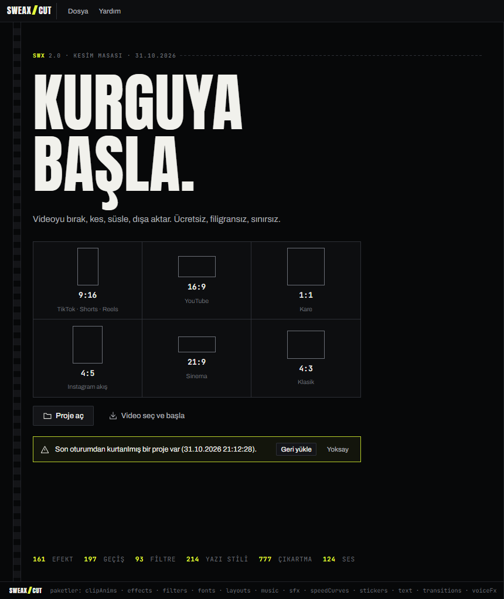
</p>

1. [Son sürümden](https://github.com/Sweax3169/sweaxcut/releases/latest) `SWEAXCUT-Kurulum-2.0.1.exe` dosyasını indir (yaklaşık 207 MB).
2. Çalıştır. Yalnız senin kullanıcı hesabına kurulur, masaüstüne ve Başlat menüsüne kısayol koyar, `.sweax` proje dosyalarını tanır ve programı açar.
3. Başlangıç ekranında en-boy oranını seç (Shorts, TikTok ve Reels için 9:16, YouTube için 16:9), sonra videonu pencereye sürükle.

> [!IMPORTANT]
> Kurulum dosyası kod imzalı değil; Windows SmartScreen ilk seferde mavi bir uyarı gösterebilir. **Ek bilgi**'ye, ardından **Yine de çalıştır**'a tıkla.

**Gereksinimler:** 64 bit Windows 10 ya da 11 ve WebGL 2 destekleyen bir ekran kartı. Donanım kodlayıcısı (NVIDIA, AMD ya da Intel) dışa aktarmayı hızlandırır ama şart değildir.

<br>

## Kaynaktan derleme

```bash
git clone https://github.com/Sweax3169/sweaxcut.git
cd sweaxcut
npm install                # MediaPipe wasm çalışma zamanını public/ altına da kopyalar (scripts/copy-mediapipe.cjs)
npm run prepare:vendor     # Piper'ı, gömülü Türkçe sesi ve RNNoise modellerini vendor/ altına indirir
```

whisper.cpp'yi indiren bir betik yok. [`b5454` sürümündeki](https://github.com/ggml-org/whisper.cpp/releases/tag/b5454) `whisper-blas-bin-x64.zip` dosyalarını ve Microsoft Visual C++ çalışma zamanı DLL'lerini (`msvcp140.dll`, `vcruntime140.dll`, `vcruntime140_1.dll`, `vcomp140.dll`) `vendor/whisper/bin/` içine koy. Bu ikililerin hiçbiri git'te tutulmuyor; ayrıntılar [THIRD_PARTY_NOTICES.md](THIRD_PARTY_NOTICES.md) dosyasında.

```bash
npm run dev                # 5199 numaralı bağlantı noktasında Vite geliştirme sunucusu
npm run start:dev          # ona bağlanan Electron penceresi
npm run dist               # üretim derlemesi ve release/ altına NSIS kurulum dosyası
```

Bu sayfadaki görseller gerçek programdan alındı. `scripts/docs-media/footage.html` örnek görüntüleri özgün GLSL sahnelerinden üretir, `drive.cjs` programı geçici bir profille açıp Chrome DevTools Protokolü üzerinden sürer, `encode.cjs` kaydedilen kareleri MP4 ve GIF'e çevirir, `readme-art.cjs` başlık görselini ve hat şemasını çizer.

<br>

## Proje yapısı

```
sweaxcut/
├─ electron/main.cjs        ana süreç: pencere, dosya pencereleri, klasör yolları
├─ src/
│  ├─ core/                 proje modeli, geri alınabilir durum, zaman çizelgesi işlemleri, anahtar kare, yumuşatma, medya içe aktarma
│  ├─ engine/               WebGL2 bileşimci, gölgelendiriciler, oynatma, ses motoru, yazı ve çıkartma çizimi
│  │  └─ export/            çözücüler, ekran kartında YUV paketleme, kodlayıcı seçimi, ses miksi
│  ├─ features/             captions (whisper.cpp), tts (Piper, Windows sesleri), video (yapay zekâ araçları), audio (çözümleme)
│  ├─ packs/                efekt, geçiş, filtre, yazı, yazı tipi, çıkartma, ses efekti, müzik, hız eğrisi, ses değiştirici, düzen
│  ├─ platform/node.js      arayüzün Node'a eriştiği tek yer
│  └─ ui/                   başlangıç ekranı, düzenleyici, kütüphane, özellik paneli, zaman çizelgesi, önizleme
├─ public/                  yazı tipleri, Twemoji SVG'leri, MediaPipe modelleri
├─ vendor/                  Piper, RNNoise modelleri, whisper.cpp (ikililer git'te değil)
├─ scripts/                 vendor indirme, testler ve belge görselleri için program sürücüleri
├─ dev/                     her içerik paketi için test sayfaları
├─ docs/                    internet sitesi, README görselleri, ekran görüntüleri, lisans notları
└─ legacy/                  1. sürümün (dikey video dönüştürücü) kaynak kodu
```

<br>

## Emeği geçenler ve lisanslar

SWEAXCUT'ı **Sweax Studios** yaptı. Şu açık kaynak projelerin üzerine kurulu:

- **[Twemoji](https://github.com/jdecked/twemoji)**: emoji grafikleri © Twitter, Inc ve diğer katkıda bulunanlar, [CC-BY 4.0](https://creativecommons.org/licenses/by/4.0/) lisansıyla.
- **[gl-transitions](https://github.com/gl-transitions/gl-transitions)**: geçişlerin 125'i (MIT; ikisi BSD).
- **[whisper.cpp](https://github.com/ggml-org/whisper.cpp)** (MIT), OpenAI Whisper modelleri (MIT) ve Silero VAD (MIT): altyazı.
- **[Piper](https://github.com/rhasspy/piper)** (MIT) ve eSpeak NG (GPL-3.0): metinden sese. Gömülü *Fahrettin* sesi CC0; isteğe bağlı *dfki* Türkçe sesi CC BY-NC-SA 4.0 lisanslıdır, ticari işte kullanılamaz.
- **[FFmpeg](https://ffmpeg.org)** (gyan.dev'in GPL-3.0 derlemesi): çözme, kodlama, sabitleme ve ses filtreleri için ayrı bir program olarak çalışır.
- **[MediaPipe](https://github.com/google-ai-edge/mediapipe)** (Apache-2.0): arka plan silme ve yüz algılama.
- **[Electron](https://www.electronjs.org)**, **[React](https://react.dev)** ve **[Vite](https://vite.dev)** (MIT).
- **101 yazı tipi ailesi**, Google Fonts'tan Fontsource üzerinden: 100'ü SIL Open Font License, Luckiest Guy Apache-2.0.

Gömülü her bileşen lisansı ve kaynağıyla **[THIRD_PARTY_NOTICES.md](THIRD_PARTY_NOTICES.md)** dosyasında listeli. Efektler, filtreler, geçişlerin 72'si, vektör çıkartmalar, müzikler ve ses efektleri SWEAXCUT için yapıldı, üçüncü taraf varlık içermez.

## Lisans

SWEAXCUT'ın kaynak kodu [MIT Lisansı](LICENSE) ile yayımlanır. © 2026 Sweax Studios.
